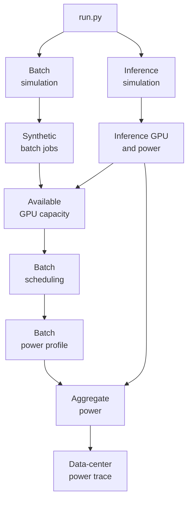

# Hybrid AI Data-Center Workload & Power Simulator

The simulator generates synthetic inference and batch workloads from fitted statistical models, schedules workloads under different scheduling policies, generates workload-level power time series, and produces an aggregated data-center power profile.

This repository is the code companion to **[Workload composition smooths aggregate power demand but leaves short-horizon ramping elevated in AI data centers](https://arxiv.org/abs/2604.10769)** (Subir Majumder, Minlan Yu, and Le Xie). It contains the simulator described in the paper's **main-text Methods** section, along with the calibrated model artifacts needed to run it. The broader [Zenodo replication package](https://doi.org/10.5281/zenodo.23417248) archives the experimental results obtained using this simulator. It also contains processed public data, calibrated model artifacts, and codes to reproduce/validate calibrated model artifacts used in this simulator.

At a high level, the simulator performs the following pipeline:



Inference workloads are simulated first because they have priority access to GPUs; batch jobs are then scheduled on the remaining available capacity. 

The batch workload models are calibrated using traces from a university computing cluster, whereas the inference workload models are calibrated using production-system traces. These traces do not represent the full diversity of AI data-center workloads. The scheduling policies implemented in this simulator are simplified abstractions. Multiple batch-job scheduling policies are included to assess the sensitivity of data-center power-demand results to scheduling assumptions. 

**Scope and limitations**
>
> - The simulator models only workload-driven power. Cooling, on-site storage, backup generation, and other facility-level controls are not modeled.
> - Batch power templates are calibrated on `V100 GPUs with an assumed rated power of 350 W` and rescaled to an `H100 80GB HBM3 GPUs with a rated power of 700 W` (see `GPU_POWER_SCALE` below).
> - Inference arrival and token models are calibrated on `one week` of production trace data; longer simulations repeat that calendar pattern and are not independent samples of it.
> - Outputs are synthetic and are intended only for *relative* comparisons of variability across workload compositions and scheduling policies. They are not intended as a authoritative representation of data-center power demand.

---
## Environment

This project was tested with:

- Python 3.10.16
- NumPy 1.26.4
- pandas 2.2.3
- tqdm 4.67.1
- matplotlib 3.10.1
- statsmodels 0.14.4

Install dependencies with:

```bash
pip install -r requirements.txt
```

> The fitted-model `.pkl` files were saved with the versions listed above and may fail to load, or load incorrectly, under different statsmodels / NumPy / pandas versions. You may regenerate the artifacts (see *Regenerating the calibrated artifacts* below).
> 
---
## Model files needed

The simulator expects the processed model artifacts under `ProcessedData_Models/` and the inference energy table under `data/ml_energy_data/`. These files are provided in this repository and are the same as those in the Zenodo replication package.

```text
data/ml_energy_data/inference_token_energy.csv
ProcessedData_Models/Inference/   nb2_model_alpha.pkl
                                  conv_generated_tokens_model.json
                                  code_generated_tokens_model.json
ProcessedData_Models/Batch/       nb_time_mu_alpha_bundle.pkl
                                  batch_hourlyarrival_ln_alr.pkl
                                  batch_cluster_tl_gpu_dist.pkl
                                  batch_runtime_dist.pkl
                                  power_data_ts_distribution/  (leaf_ts.csv, ts_bins.csv, template CSVs)
```

`inference_token_energy.csv` columns: `Model, Max_BS_(reqs), TP, PP, Energy/req_(J), Avg TPOT_(s), Avg_Output_Tokens, Token_Speed`. These measurements were obtained from **[ML.ENERGY](https://ml.energy/leaderboard/)** and are also archived in **Supplementary Table 4** of the accompanying paper.

> The `.pkl` files are Python pickles. Only load files from sources you trust. You can regenerate them by running the calibration code in the Zenodo package.

**Regenerating the calibrated artifacts**

> The files above are produced by the calibration code in the Zenodo package. Raw data sources:
>
> - **Batch jobs and power profiles:** MIT SuperCloud dataset (`s3://mit-supercloud-dataset/datacenter-challenge/202201/`)
> - **Inference requests:** Azure LLM Inference Dataset 2024 (https://github.com/Azure/AzurePublicDataset/blob/master/AzureLLMInferenceDataset2024.md)
> - **Inference serving energy:** ML.ENERGY leaderboard (https://ml.energy/leaderboard/)
>
> | Artifact | Produced by (Zenodo script) | Raw input |
> | --- | --- | --- |
> | `nb_time_mu_alpha_bundle.pkl` | `Analysis_ModelBuild/Supp_Tab_1_Supp_Fig_2_3.py` | MIT SuperCloud |
> | `batch_hourlyarrival_ln_alr.pkl` | `Analysis_ModelBuild/Supp_Fig_4.py` | MIT SuperCloud |
> | `batch_cluster_tl_gpu_dist.pkl`, `batch_runtime_dist.pkl` | `Analysis_ModelBuild/Supp_Fig_5_6.py` | MIT SuperCloud |
> | `power_data_ts_distribution/` | `Analysis_ModelBuild/Supp_Fig_7_8.py` | MIT SuperCloud |
> | `nb2_model_alpha.pkl` | `Analysis_ModelBuild/Supp_Tab_2_3_Supp_Fig_13_14_15.py` | Azure LLM trace |
> | `conv_generated_tokens_model.json`, `code_generated_tokens_model.json` | `Analysis_ModelBuild/Supp_Tab_2_3_Supp_Fig_13_14_15.py` | Azure LLM trace |
> | `inference_token_energy.csv` | n/a (Supp. Table 4) | ML.ENERGY |
> 
>
> Regenerated artifacts are expected to exactly match the shipped ones.

---
## Running a scenario

1. Clone the repository (the model files are included).
2. Edit the configuration block at the top of `main()` in `run.py`.
3. Run:

```bash
python run.py
```

The result is written to `Results/` with the main parameters in the file name, for example
`power_frac=0p3_gpus=250_util=0p81_verb=0.6_speed=F_..._scheduler=SWF_pol=1.csv`.

Every module can also run alone: each has a `__main__` block with example defaults, reading and writing under `Temp/`.

---
### Configurations
All parameters are set at the top of `main()` in `run.py`.

| Parameter | Default | Description |
|-----------|---------|-------------|
| `SIMULATION_START_DATE` | `"2026-01-03"` | First simulated day (`YYYY-MM-DD`). |
| `N_DAYS` | `90` | Length of the simulation, in days. |
| `frac` | `0.3` | Fraction of offered workload assigned to inference. The remaining `1 - frac` goes to batch. `0` = batch only, `1` = inference only. |
| `TOTAL_GPUS` | `250` | Total GPUs in the shared cluster. |
| `UTIL_RATE` | `0.81` | Label only: does not control utilization. |
| `policy` | `1` | Inference GPU allocation: `0` = **Capped** (limited to `frac * TOTAL_GPUS`), `1` = **Uncapped** (up to `TOTAL_GPUS`). |
| Inference | | |
| `INF_TRAFFIC_SCALE_RAW` | `2.85` | Scaling of inference arrival rates. The effective scale is `frac * INF_TRAFFIC_SCALE_RAW`. |
| `VERBOSITY_SCALE` | `0.6` | Multiplier on generated-token lengths (`< 1` shorter outputs, `> 1` longer). |
| `TOKEN_SPEED` | `"F"` | Token-generation speed class used to select model configurations: `"F"` fast, `"M"` medium, `"S"` slow. Classes are defined by average time per output token (see Supplementary Table 4). |
| Batch | | |
| `BAT_TRAFFIC_SCALE_RAW` | `0.85` | Scaling of batch arrival rates. |
| `LO_COEFF`, `MID_COEFF`, `HIGH_COEFF` | `1`, `1.2`, `1.2` | Multipliers for the low-, mid- and high-resource job groups. |
| `COEFF_MULTIPLIERS` | derived | Per-group multipliers actually applied: `(1 - frac) * BAT_TRAFFIC_SCALE_RAW * <group coeff>`. |
| `N_TZ` | `5` | Number of time-zone offsets in the batch arrival model. `N_TZ = 5` is the multi-time-zone variant |
| `SEGMENT_DURATION` | `7200` | Checkpoint segment length for batch jobs, in seconds. |
| `SCHEDULER` | `"SWF"` | `"FCFS_BKFL"` = first-come-first-served with backfilling; `"SWF"` = greedy smallest-work-first (sorted by GPUs, then runtime). SWF uses realized runtimes (clairvoyant). We use these schedulers as a part of sensitivity analysis. Please check our scheduler implementation for details. |

**Targeting a utilization.** Utilization is not an input. It results from `TOTAL_GPUS` and the traffic-scale parameters. 

---
## Outputs

**Final result** (`Results/*.csv`), one row per minute in the simulation window:

| Column | Description |
|--------|-------------|
| `timestamp` | Minute timestamp |
| `power_batch_kW`, `power_inference_kW`, `power_total_kW` | Power in kW. `power_total_kW` does not include idle GPU power. |
| `running_batch_gpus`, `running_inf_gpus` | GPUs in use |
| `batch_arrivals`, `inf_arrivals` | Arrivals per minute |
| `running_request_batch` | Running batch segments |

`run_combined_power_analysis` also returns `mean_delay`, the mean delay in batch job completion in minutes. `run.py` does not write it to disk.

**Intermediate files** are written to `Temp/` (inference profiles, daily and second-level batch arrivals, hourly capacity, scheduled jobs, batch power series).

---
## Modeling assumptions and conventions

- Time limits are in minutes, runtimes in seconds, power in kW, and all times are naive timestamps.
- Inference has priority. Batch only sees the capacity left after the hourly peak of inference GPU use.
- The power scaling constant (`GPU_POWER_SCALE = 2.0`) is hard-coded in `aggregate_power_profiles.py`.
- Segments of one job are assumed to share cluster, GPU count, time limit and runtime. Power samples beyond the segments' total duration are discarded.

---
## Reproducibility

Random seeds are fixed in each module, so identical configurations reproduce identical outputs. Change the seeds in the source to run independent replications.

---
## Repository layout

``run.py`` imports each module from the folders below, so keep this structure.

```text
.
├── run.py                                   # main orchestrator (edit config here)
├── inference_generate_simulate/
│   └── inference_generate_simulate.py       # Generate inference arrivals, tokens, concurrency, GPUs and power
├── batch_submission/
│   ├── generate_daily_arrival.py            # Generate daily batch job counts per cluster and time zone
│   ├── generate_hourly_arrival.py           # Spread daily counts to hourly bins, then to second-level submit times
│   └── generate_resource_needs.py           # Attach timelimit, gpu_alloc, runtime to each job
├── batch_schedule/
│   ├── capacity.py                          # Compute hourly GPU capacity left over after inference
│   └── scheduler.py                         # Schedule batch jobs (segmented, dependency-chained) on leftover capacity
├── batch_power/
│   └── aggregate_power_profiles.py          # Generate per-job power time series and sum them
├── aggregate/
│   └── aggregated_batch_inf_power.py        # Merge batch + inference into facility-level metrics
├── data/
│   └── ml_energy_data/
│       └── inference_token_energy.csv
└── ProcessedData_Models/
|   ├── Inference/                           # fitted inference models
│   │   ├── nb2_model_alpha.pkl
│   │   ├── conv_generated_tokens_model.json
│   │   └── code_generated_tokens_model.json
|   └── Batch/                               # fitted batch models + power templates
│       ├── nb_time_mu_alpha_bundle.pkl
│       ├── batch_hourlyarrival_ln_alr.pkl
│       ├── batch_cluster_tl_gpu_dist.pkl
│       ├── batch_runtime_dist.pkl
│       └── power_data_ts_distribution/       # fitted power templates for batch jobs
├── Temp/
└── Results/
```

`Temp/` stores intermediate simulation outputs. `Results/` stores final experiment-level power traces. Both folders are created automatically during simulation.

---
## Citation and license

```bibtex
@misc{majumder2026workload,
  author        = {Majumder, Subir and Yu, Minlan and Xie, Le},
  title         = {Workload composition smooths aggregate power demand but leaves
                   short-horizon ramping elevated in {AI} data centers},
  year          = {2026},
  eprint        = {2604.10769},
  archivePrefix = {arXiv},
  note          = {Replication package: https://doi.org/10.5281/zenodo.23417248}
}
```
Released under the MIT license; see `LICENSE`.

---
## Contact

- Subir Majumder: research@subirmajumder.com
- Minlan Yu: minlanyu@g.harvard.edu
- Le Xie: xie@seas.harvard.edu 
