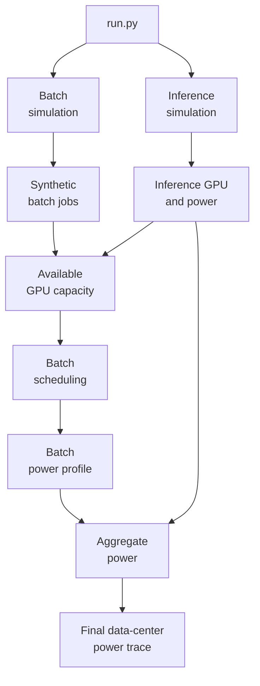

# Hybrid AI Data-Center Workload & Power Simulator

The simulator generates synthetic inference and batch workloads from fitted statistical models, schedules workloads under different scheduling policies, generates workload-level power time series, and produces an aggregated data-center power profile.

Code companion to:

> **Workload composition smooths aggregate power demand but leaves short-horizon ramping elevated in AI data centers**
> Subir Majumder, Minlan Yu, Le Xie (Harvard University; Texas A&M University)
> ([link](https://arxiv.org/abs/2604.10769))

The paper describes the model, calibration and results. This repository contains the full scenario-generation simulator.

| Resource | Where |
|----------|-------|
| Simulator (this repo) | scenario generation, scheduling, power co-simulation |
| Replication package (Zenodo) | calibration code, processed model artifacts, supporting data, archived experiment outputs, and post-analysis scripts to reproduce the paper's figures and tables: <https://doi.org/10.5281/zenodo.21938360> |
| Raw traces | MIT SuperCloud (`s3://mit-supercloud-dataset/datacenter-challenge/202201/`), Azure LLM inference 2024 ([link](https://github.com/Azure/AzurePublicDataset/blob/master/AzureLLMInferenceDataset2024.md)), ML.ENERGY leaderboard ([link](https://ml.energy/leaderboard/)) |

## Overview
Modern GPU clusters may simultaneously serve latency-sensitive inference workloads and long-running batch jobs. Batch and inference workloads differ substantially in their arrival patterns, GPU requirements, runtimes, and power-consumption profiles. In addition, batch jobs can wait in scheduler-managed queues and, in some cases, can be paused and resumed through checkpointing. Inference workloads, by contrast, are latency-sensitive. Inference workload serving systems seek to keep queues short, process requests through continuous batching, and reroute requests when available GPUs cannot accommodate additional demand.

This simulator provides an end-to-end framework for studying such mixed workloads. 

At a high level, the simulator performs the following pipeline:

Inference is simulated first because it has priority on the GPUs; batch jobs are scheduled on the capacity it leaves free.

## Environment

This project was tested with:

- Python 3.10.16
- NumPy 1.26.4
- pandas 2.2.3
- tqdm 4.67.1
- matplotlib 3.10.1
- statsmodels 0.14.4

Install dependencies with:

```bash
pip install -r requirements.txt
```
## Model files needed

The simulator expects the processed model artifacts under ``ProcessedData_Models/`` and the inference energy table under ``data/ml_energy_data/``. These files are provided in this repository. These files are same as those provided in the Zenodo replication package.

```
data/ml_energy_data/inference_token_energy.csv
ProcessedData_Models/Inference/   nb2_model_alpha.pkl
                                  conv_generated_tokens_model.json
                                  code_generated_tokens_model.json
ProcessedData_Models/Batch/       nb_time_mu_alpha_bundle.pkl
                                  batch_hourlyarrival_ln_alr.pkl
                                  batch_cluster_tl_gpu_dist.pkl
                                  batch_runtime_dist.pkl
                                  power_data_ts_distribution/  (leaf_ts.csv, ts_bins.csv, template CSVs)
```

`inference_token_energy.csv` columns: `Model, Max_BS_(reqs), TP, PP, Energy/req_(J), Avg TPOT_(s), Avg_Output_Tokens, Token_Speed`.

> The `.pkl` files are Python pickles. Only load files from sources you trust. You can generate those pickle files by running the calibration codes in Zenodo.

---

## Running a scenario

1. Put the model files in place.
2. Edit the configuration block at the top of `main()` in `run.py`.
3. Run:

```bash
python run.py
```

The result is written to ``Results/`` with the main parameters in the file name, for example
``power_frac=0p3_gpus=250_util=0p81_verb=0.6_speed=F_..._scheduler=SWF_pol=1.csv``.

Every module can also run alone: each has a ``__main__`` block with example defaults reading and writing under `Temp/`.

---

### Configurations
All parameters are set at the top of `main()` in `run.py`.

| Parameter | Default | Description |
|-----------|---------|-------------|
| `SIMULATION_START_DATE` | `"2026-01-03"` | First simulated day (`YYYY-MM-DD`). |
| `N_DAYS` | `90` | Length of the simulation, in days. |
| `frac` | `0.3` | Fraction of offered workload assigned to inference. The remaining `1 - frac` goes to batch. `0` = batch only, `1` = inference only. |
| `TOTAL_GPUS` | `250` | Total GPUs in the shared cluster. |
| `UTIL_RATE` | `0.81` | Target utilization. Used only in the output file name; actual utilization is set by the traffic-scale parameters below, which should be tuned for the chosen `TOTAL_GPUS`. |
| `policy` | `1` | Inference GPU allocation: `0` = **Capped** (limited to `frac * TOTAL_GPUS`), `1` = **Uncapped** (up to `TOTAL_GPUS`). |
| Inference |---------|-------------|
| `INF_TRAFFIC_SCALE_RAW` | `2.85` | Baseline scaling of inference arrival rates. The effective scale is `frac * INF_TRAFFIC_SCALE_RAW`. |
| `VERBOSITY_SCALE` | `0.6` | Multiplier on generated-token lengths (`< 1` shorter outputs, `> 1` longer). |
| `TOKEN_SPEED` | `"F"` | Token-generation speed class used to select model configurations: `"F"` fast, `"M"` medium, `"S"` slow. |
| Batch |---------|-------------|
| `BAT_TRAFFIC_SCALE_RAW` | `0.85` | Baseline scaling of batch arrival rates. |
| `LO_COEFF`, `MID_COEFF`, `HIGH_COEFF` | `1`, `1.2`, `1.2` | Multipliers for the low-, mid- and high-resource job groups. |
| `COEFF_MULTIPLIERS` | derived | Per-group multipliers actually applied: `(1 - frac) * BAT_TRAFFIC_SCALE_RAW * <group coeff>`. |
| `N_TZ` | `5` | Number of time-zone offsets in the batch arrival model. |
| `SEGMENT_DURATION` | `7200` | Checkpoint segment length for batch jobs, in seconds. |
| `SCHEDULER` | `"SWF"` | `"FCFS_BKFL"` = first-come-first-served with backfilling; `"SWF"` = greedy smallest-work-first (sorted by GPUs, then runtime). |

## Outputs

**Final result** (`Results/*.csv`), one row per minute in the simulation window:

| Column | Description |
|--------|-------------|
| `timestamp` | Minute timestamp |
| `power_batch_kW`, `power_inference_kW`, `power_total_kW` | Power in kW |
| `running_batch_gpus`, `running_inf_gpus` | GPUs in use |
| `batch_arrivals`, `inf_arrivals` | Arrivals per minute |
| `running_request_batch` | Running batch segments |

`run_combined_power_analysis` also returns `mean_delay`, the mean extra time in minutes between a batch job's submission and its completion beyond its own runtime. `run.py` does not write it to disk.

**Intermediate files** are written to `Temp/` (inference profiles, daily and second-level batch arrivals, hourly capacity, scheduled jobs, batch power series).

---

## Modeling assumptions and conventions
-- Time limits are in minutes, runtimes in seconds, power in kW, and all times are naive timestamps.

-- Inference has priority. Batch only sees the capacity left after the hourly peak of inference GPU use.

-- Power scaling constants (``GPU_POWER_SCALE = 2.0``) are hard-coded in aggregate_power_profiles.py.

-- Segments of one job are assumed to share cluster, GPU count, time limit and runtime. Power samples beyond the segments' total duration are discarded.

## Reproducibility

Random seeds are fixed in each module, so identical configurations reproduce identical outputs. Change the seeds in the source to run independent replications.

## Repository layout

``run.py`` imports each module from the folders below, so keep this structure.

```text
.
├── run.py                                   # main orchestrator (edit config here)
├── inference_generate_simulate/
│   └── inference_generate_simulate.py       # Generate inference arrivals, tokens, concurrency, GPUs and power
├── batch_submission/
│   ├── generate_daily_arrival.py            # Generate daily batch job counts per cluster and time zone
│   ├── generate_hourly_arrival.py           # Spread daily counts to hourly bins, then to second-level submit times
│   └── generate_resource_needs.py           # Attach timelimit, gpu_alloc, runtime to each job
├── batch_schedule/
│   ├── capacity.py                          # Compute hourly GPU capacity left over after inference
│   └── scheduler.py                         # Schedule batch jobs (segmented, dependency-chained) on leftover capacity
├── batch_power/
│   └── aggregate_power_profiles.py          # Generate per-job power time series and sum them
├── aggregate/
│   └── aggregated_batch_inf_power.py        # Merge batch + inference into facility-level metrics
├── data/
│   └── ml_energy_data/
│       └── inference_token_energy.csv
└── ProcessedData_Models/
|   ├── Inference/                           # fitted inference models
│   │   ├── nb2_model_alpha.pkl
│   │   ├── conv_generated_tokens_model.json
│   │   └── code_generated_tokens_model.json
|   └── Batch/                               # fitted batch models + power templates
│       ├── nb_time_mu_alpha_bundle.pkl
│       ├── batch_hourlyarrival_ln_alr.pkl
│       ├── batch_cluster_tl_gpu_dist.pkl
│       ├── batch_runtime_dist.pkl
│       └── power_data_ts_distribution/       # fitted power templates for batch jobs
├── Temp/
└── Results/
```

Temp/ stores intermediate simulation outputs. Results/ stores final experiment-level power traces. Folders are automatically generated during simulation. 

## Citation and license

```bibtex
@article{majumder2026workload,
  author  = {Majumder, Subir and Yu, Minlan and Xie, Le},
  title   = {Workload composition smooths aggregate power demand but leaves
             short-horizon ramping elevated in {AI} data centers},
  year    = {2026},
  note    = {Replication package: https://doi.org/10.5281/zenodo.21938360}
}
```
Released under the MIT license, see LICENSE.

## Contact

Subir Majumder: research@subirmajumder.com
Minlan Yu:
Le Xie: 
